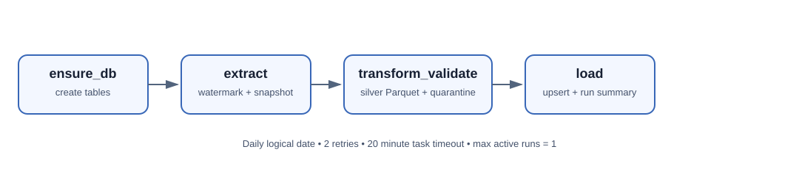
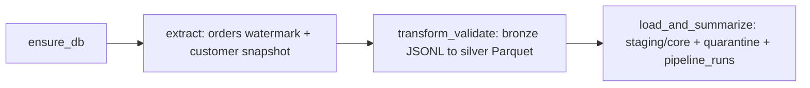

# Incremental Validated Retail Pipeline

An Airflow daily pipeline that reads orders incrementally from [DummyJSON](https://dummyjson.com/docs/carts) and reads customers as a complete snapshot. Orders and customers land as JSON Lines in `data/bronze/YYYY-MM-DD/`, are converted to typed/deduplicated Parquet in `data/silver/YYYY-MM-DD/`, validated with Pandera, and loaded into PostgreSQL staging/core tables. Invalid rows are recorded in `quarantine` with the failed entity and rule. All pipeline data access modules can run without importing Airflow.

## Architecture





Orders use DummyJSON cart IDs as a monotonically increasing high-water mark held in `pipeline_state`. A run writes its original extraction under the logical date; rerunning that same date reuses its bronze orders so a later watermark cannot erase previously loaded rows. Customer rows are refreshed from a full source snapshot on every run. PostgreSQL upserts and date-scoped replacement make retries safe. Backfills are serialized (`max_active_runs=1`) so the watermark advances in order.

## Start the stack

Requirements: Docker Compose v2. Copy `.env.example` to `.env`, then change the local development passwords, including the Airflow admin password, before exposing services outside your machine. From the repository root:

```bash
docker compose up airflow-init
docker compose up -d
```

Airflow is at <http://localhost:8080>; log in with `AIRFLOW_ADMIN_USERNAME` and `AIRFLOW_ADMIN_PASSWORD` from `.env`. PostgreSQL is published on port `5432`; its application database and user are configured through `.env`. The source URL can be changed with `SOURCE_BASE_URL`, for example to a compatible mock API. Data is persisted in the local `data/` directory and the Compose PostgreSQL volume.

## Run and backfill

Enable `retail_incremental_validated_pipeline` in the Airflow UI. To run a seven-day backfill, use Airflow's CLI in the scheduler container:

```bash
docker compose exec airflow-scheduler airflow dags backfill retail_incremental_validated_pipeline \
  --start-date 2024-01-01 --end-date 2024-01-07
```

Then rerun one logical date to check idempotency:

```bash
docker compose exec airflow-scheduler airflow dags backfill retail_incremental_validated_pipeline \
  --start-date 2024-01-03 --end-date 2024-01-03
```

Compare counts before and after:

```bash
docker compose exec postgres psql -U retail -d retail -c "SELECT 'core_orders' AS table_name, count(*) FROM core_orders UNION ALL SELECT 'core_customers', count(*) FROM core_customers UNION ALL SELECT 'quarantine', count(*) FROM quarantine;"
```

Each backfill logical date is present in `pipeline_runs`. The following is the captured output from the seven-day backfill and the January 3 rerun in this workspace (DummyJSON returned 208 carts and 208 customers at run time):

| run_date | orders_extracted | customers_extracted | orders_loaded | customers_loaded | rows_quarantined | status |
|---|---:|---:|---:|---:|---:|---|
| 2024-01-01 | 208 | 208 | 208 | 208 | 0 | success |
| 2024-01-02 | 0 | 208 | 0 | 208 | 0 | success |
| 2024-01-03 | 0 | 208 | 0 | 208 | 0 | success |
| 2024-01-04 | 0 | 208 | 0 | 208 | 0 | success |
| 2024-01-05 | 0 | 208 | 0 | 208 | 0 | success |
| 2024-01-06 | 0 | 208 | 0 | 208 | 0 | success |
| 2024-01-07 | 0 | 208 | 0 | 208 | 0 | success |

Table counts before and after the January 3 rerun were unchanged: `stg_orders=208`, `core_orders=208`, `stg_customers=208`, `core_customers=208`, and `quarantine=0`. The rerun refreshed the January 3 `pipeline_runs` row. Exact counts can vary with the public source snapshot.

To inspect the full run output, including recorded durations, use:

```sql
SELECT run_date, orders_extracted, customers_extracted, orders_loaded,
       customers_loaded, rows_quarantined, duration_seconds, status
FROM pipeline_runs ORDER BY run_date;
```

## Tables and checks

- `pipeline_state`: current order ID high-water mark.
- `stg_orders`, `stg_customers`: idempotent staging tables.
- `core_orders`, `core_customers`: reporting tables loaded by upsert.
- `quarantine`: failed records as JSONB with entity and Pandera rule name.
- `pipeline_runs`: one summary per logical date, updated on rerun.

Pandera checks cover positive IDs, nonnegative totals/counts, required order date, valid customer email, nonempty identity/contact/location fields, and age range (10+ field checks across both schemas). A row that fails more than one check creates one quarantine record per failed rule.

## Local tests

```bash
python -m venv .venv
# Windows PowerShell: .venv\Scripts\Activate.ps1
# macOS/Linux: source .venv/bin/activate
pip install -r requirements.txt
pytest -q
```

Tests cover type conversion, deduplication, flattening, schema coverage, valid records, and invalid email/value/null fixtures. The unit tests do not require Docker or a database.

## Project layout

```text
dags/                 Airflow TaskFlow DAG
retail_pipeline/      Airflow-independent extraction, transforms, validation, DB loading
sql/init.sql          Creates the application database and user
tests/                pytest unit tests
data/bronze/          Date-keyed source JSONL (created at runtime)
data/silver/          Date-keyed typed Parquet (created at runtime)
```

